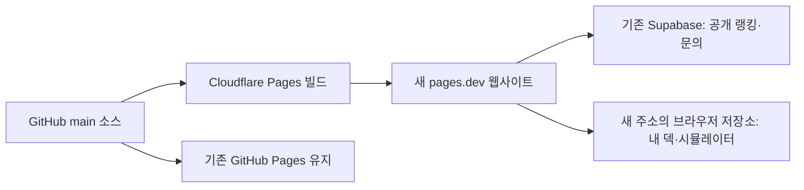

# Cloudflare Pages 이전 준비

현재 상태: 코드와 빌드 절차 준비. Cloudflare 프로젝트 생성·계정 연결·주소 전환은 아직 하지 않았다. 기존 GitHub Pages와 Supabase는 계속 운영한다. 노트북에서 실행하는 개인용 프로그램은 이 웹 배포에 포함하지 않는다.

## 구조



웹 호스팅 변경은 로그인이나 기기 간 자동 동기화를 추가하지 않는다. GitHub는 계속 소스 관리와 자동 배포의 출발점으로 사용한다. 무료 pages.dev 주소로 시작할 수 있고 개인 도메인은 나중에 별도 연결한다. 무료 플랜의 당시 사용량 제한은 개설 시 확인한다.

## 1. Cloudflare 프로젝트 연결

Cloudflare 대시보드의 Workers & Pages에서 **Pages / Git 저장소 연결** 방식으로 프로젝트를 생성한다. Workers 배포 명령을 설정하는 방식과 구분한다. GitHub 계정에서 `huniii32/mlb-rivals-deck` 저장소 접근을 허용한다.

| 설정 | 값 |
|---|---|
| Production branch | `main` |
| Root directory | 저장소 루트 |
| Build command | `npm run build:cloudflare` |
| Build output directory | `dist` |
| `NODE_VERSION` | `22` |
| `VITE_SUPABASE_URL` | 현재 사이트와 같은 Supabase 프로젝트 URL |
| `VITE_SUPABASE_ANON_KEY` | 해당 프로젝트의 브라우저용 publishable 또는 anon 키 |

키 값을 문서·커밋·채팅에 붙이지 말고 Cloudflare 빌드 환경 변수에 설정한다. `VITE_` 변수는 최종 브라우저 코드에 포함되므로 service_role/secret 키는 넣지 않는다. GitHub Actions의 환경 변수/Secrets가 Cloudflare로 자동 복사되지는 않는다.

빌드 명령은 `VITE_BASE=/`를 강제하고 필수 Supabase 설정을 확인한다. 기존 GitHub Pages 워크플로는 `VITE_BASE=/mlb-rivals-deck/ npm run build`를 그대로 유지한다. 별도의 서버·Wrangler 토큰·새 DB는 필요하지 않다.

Preview 배포를 사용할 경우 환경 변수도 별도로 설정해야 한다. 운영 Supabase를 연결한 Preview에서 덱 저장·랭킹 수정·문의 전송은 실제 운영 데이터에 반영된다. 개발용 쓰기 검증은 별도 테스트 Supabase로 진행하고, 첫 운영 확인은 조회부터 시작한다.

## 2. 새 주소 검증

- 루트 주소와 `/#simulator`에 접속하고 새로고침한다.
- 라인업 일러스트/표 보기, 산정방식, 시뮬레이터 3종을 확인한다.
- 공개 덱랭킹이 기존 사이트와 같은 목록인지 확인한다. 이 작업에 랭킹 초기화 SQL이나 스키마 재설치는 필요 없다.
- 본인이 관리하는 덱으로만 가져오기·수정·동기화를 검증한다. 조회만으로 다른 사용자의 랭킹을 변경하지 않는다.
- 모바일·PC 화면, 덱 JSON 백업/가져오기, 공유 링크를 확인한다. 공유 링크는 현재 접속한 주소를 기준으로 생성된다.
- 개인용 도감 수집기·자동변경 프로그램과 다운로드 파일은 올리지 않는다.

현재 앱은 Supabase 로그인 리다이렉트를 사용하지 않는다. 호스팅 이전만을 위해 Auth Site URL이나 RLS를 변경하지 않는다. 추후 로그인을 구현할 때 콜백 주소를 별도로 설정한다.

## 3. 사용자의 내 덱 이전

브라우저 저장소는 **주소(origin)별로 분리**된다. 새 주소에서 내 덱이 보이지 않아도 기존 주소의 덱이 삭제된 것은 아니다.

1. 실제로 최신 덱을 보유한 기기에서 기존 사이트를 연다. 이름 없는 덱이 있으면 먼저 이름을 정해 저장한다.
2. `덱 도구 → 파일 백업 → 전체 N개 백업`을 받는다. 덱이 하나면 `현재 덱 백업`을 사용한다.
3. 새 사이트에서 `덱 도구 → 파일 불러오기 → 파일 선택`으로 JSON을 불러온다.
4. 선수·전술·점수와 랭킹 연결 상태를 확인한다. 연결 정보가 포함된 백업은 기존 랭킹 수정 권한을 이어받는다.

또는 공개 랭킹에 있는 최신 덱을 숫자 4자리 비밀번호로 가져올 수 있다. 랭킹에 올리지 않은 덱은 파일 백업을 사용해야 한다. 백업에는 랭킹 수정 권한이 포함될 수 있으므로 본인 보관용으로 취급한다.

**백업 범위:** 현재 JSON은 덱과 랭킹 연결 정보를 담는다. 시뮬레이터 기록·화면 설정·사용자가 수정한 스킬 점수표는 포함하지 않는다. 이 항목들은 새 주소로 자동 이전되지 않는다. 기존 주소를 유지해 기록을 확인할 수 있도록 한다. 시뮬레이터 기록의 파일 이전 기능은 별도 개발 범위다.

두 주소에서 같은 덱을 번갈아 수정하면 마지막 저장 내용이 랭킹에 반영될 수 있다. 이전을 확인한 뒤에는 새 주소를 편집용으로 사용하고 이전 주소는 백업 확인용으로 남긴다.

## 4. 공개 전환과 복귀

검증 후 새 주소를 공지하고 기존 사이트에 백업·가져오기 안내를 추가한다. **이 준비 단계에서는 자동 이동이나 기존 배포 중단을 설정하지 않는다.** 기존 주소를 바로 리다이렉트하면 사용자가 로컬 백업을 꺼내기 어려워진다. 기존 공유 링크도 당분간 유지한다.

문제가 생기면 기존 GitHub Pages 주소로 안내를 되돌린다. 새 주소에서만 저장한 덱은 먼저 백업해야 하며, 두 사이트가 공유하는 Supabase의 데이터 변경은 호스팅 복귀만으로 되돌아가지 않는다. Cloudflare에서 이전 배포를 복원할 경우에도 DB가 자동 복원되는 것은 아니다.

## 실행 명령과 출처

```sh
npm ci
npm run build:cloudflare
npm run preview -- --host 127.0.0.1 --port 4174
```

빌드는 `dist`만 생성하며 업로드하지 않는다. Supabase 환경 변수가 없는 경우 정상적으로 실패한다. `dist/_headers`는 HTML 재검증과 해시 자산 장기 캐시를 설정한다.

- [Cloudflare Pages Git 연동](https://developers.cloudflare.com/pages/configuration/git-integration/)
- [빌드 설정](https://developers.cloudflare.com/pages/configuration/build-configuration/)
- [헤더 설정](https://developers.cloudflare.com/pages/configuration/headers/)
- [환경 변수](https://developers.cloudflare.com/pages/configuration/build-configuration/#environment-variables)
